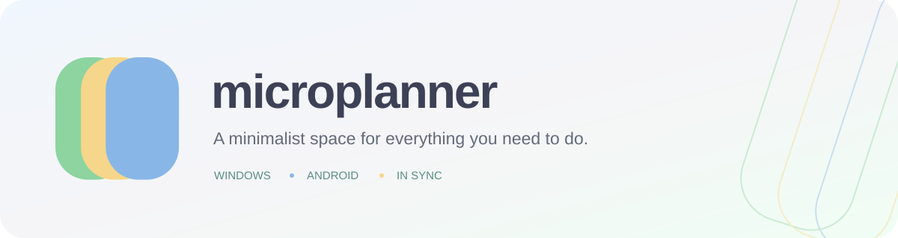

<p align="center">
  
</p>

microplanner is a small planner for Windows and Android. Keep tasks in separate
boards, organize them by subject, and see what is upcoming, late or completed.
Sign in with Google to keep your work in sync between your computer and phone.

The interface stays simple, with soft colors and small animations. Each Google
account has its own workspace. When you are offline, you can still read the last
saved copy; editing resumes when you reconnect.

## Install

### Android

<!-- android-download:start -->
[Download Android APK (0.10.0)](https://github.com/macorisd/microplanner/releases/download/v0.10.0/microplanner-0.10.0-android.apk)

[Release notes](https://github.com/macorisd/microplanner/releases/tag/v0.10.0)
<!-- android-download:end -->

1. Open [GitHub Releases](https://github.com/macorisd/microplanner/releases)
   and choose the newest version with an APK attached. Versions before 1.0 are
   published as prereleases.
2. Download `microplanner-<version>-android.apk` and open it on your phone.
   If Android asks, allow your browser or file manager to install this APK.
3. Open microplanner and sign in with Google. No USB connection is needed.

To update, install the newer APK over the existing app. Keep the existing app
installed so its local data and session remain available. The adjacent
`.apk.sha256` file lets you verify the download if needed.

### Windows

A ready-to-download Windows bundle is not published yet. You can build the app
from source with **Git** and **Flutter 3.38.6**, including its Windows desktop
build tools:

```powershell
git clone https://github.com/macorisd/microplanner.git
cd microplanner
flutter pub get
flutter build windows --release
```

Open `build/windows/x64/runner/Release/microplanner.exe` and sign in with Google.
You can copy the complete `Release` folder to another location and create a
shortcut there; keep the executable, DLLs and `data` folder together. To update,
close the app before replacing that complete bundle.

Both platforms use the hosted service by default. Google sign-in availability
follows the current OAuth project's access settings.

## Version history

The table describes changes when each version was introduced. Features may have
been refined by later versions. The unreleased row is available from source;
Android downloads appear in Releases after publication.

<!-- release-history:start -->
| Version | Changes |
| --- | --- |
| 0.10.1 (unreleased) | <ul><li>Update README download and version links automatically after verified Android publication.</li></ul> |
| [0.10.0](https://github.com/macorisd/microplanner/releases/tag/v0.10.0) | <ul><li>Edit Windows tasks by clicking their cards.</li><li>Expand descriptions in matching dialogs with the task title and Back navigation.</li><li>Save with Enter after date/time selection; limit board names to 50 characters.</li><li>Refresh the project guide and release history.</li></ul> |
| [0.9.0](https://github.com/macorisd/microplanner/tree/v0.9.0) | <ul><li>Save actions in the background and recover pending work after reopening.</li><li>Animate task moves and deletion, with confirmed synchronization and rollback on failure.</li></ul> |
| [0.8.0](https://github.com/macorisd/microplanner/tree/v0.8.0) | <ul><li>Let Android apply its own launcher icon shape.</li><li>Use Completed consistently; reveal the Windows clear action on hover.</li><li>Save descriptions with Ctrl+Enter on Windows and open editing without selecting text.</li></ul> |
| [0.7.0](https://github.com/macorisd/microplanner/tree/v0.7.0) | <ul><li>Synchronize behind an icon-only startup screen.</li><li>Remember the last column of each Android board and zoom into its logo color.</li><li>Use the animated logo in cloud progress notices.</li></ul> |
| [0.6.0](https://github.com/macorisd/microplanner/tree/v0.6.0) | <ul><li>Remember the last board per account and device.</li><li>Clear completed tasks from the current board with confirmation.</li><li>Improve priority spacing and prevent unwanted keyboard reopening.</li></ul> |
| [0.5.2](https://github.com/macorisd/microplanner/tree/v0.5.2) | <ul><li>Prevent repeated submissions and disable saving unchanged forms.</li><li>Validate text lengths and edge cases throughout the app.</li><li>Keep Windows completion hover feedback compact.</li></ul> |
| [0.5.1](https://github.com/macorisd/microplanner/tree/v0.5.1) | <ul><li>Show subject colors in task forms.</li><li>Keep accepted button actions from being lost during synchronization.</li></ul> |
| [0.5.0](https://github.com/macorisd/microplanner/tree/v0.5.0) | <ul><li>Navigate Android columns using a layered carousel and three-icon selector.</li><li>Open the sidebar with a left-edge drag and edit tasks by tapping them.</li><li>Remove the redundant refresh spinner.</li></ul> |
| [0.4.0](https://github.com/macorisd/microplanner/tree/v0.4.0) | <ul><li>Set the Windows minimum size to half the monitor dimensions.</li><li>Keep Android column colors visible when empty.</li><li>Refine Material 3 styling, responsive layouts and rendering; fix sidebar hover trails.</li></ul> |
| [0.3.0](https://github.com/macorisd/microplanner/tree/v0.3.0) | <ul><li>Show cloud progress in a floating card without moving content.</li><li>Add coordinated interface animations and reduced-motion support.</li></ul> |
| [0.2.7](https://github.com/macorisd/microplanner/tree/v0.2.7) | <ul><li>Show the Google profile photo in the sidebar.</li></ul> |
| [0.2.6](https://github.com/macorisd/microplanner/tree/v0.2.6) | <ul><li>Compact Android task controls and match system bars to the app background.</li></ul> |
| [0.2.5](https://github.com/macorisd/microplanner/tree/v0.2.5) | <ul><li>Tighten Android layouts and fit subject badges to their text.</li></ul> |
| [0.2.4](https://github.com/macorisd/microplanner/tree/v0.2.4) | <ul><li>Make Android task and sidebar controls usable without hover.</li></ul> |
| [0.2.3](https://github.com/macorisd/microplanner/tree/v0.2.3) | <ul><li>Fix recovery and verification of draft APK releases.</li></ul> |
| [0.2.2](https://github.com/macorisd/microplanner/tree/v0.2.2) | <ul><li>Support the Android SDK 37 certificate verification output.</li></ul> |
| [0.2.1](https://github.com/macorisd/microplanner/tree/v0.2.1) | <ul><li>Verify APK certificates independently of signer labels.</li></ul> |
| [0.2.0](https://github.com/macorisd/microplanner/tree/v0.2.0) | <ul><li>Host the cloud API on Vercel.</li><li>Publish signed Android APKs as GitHub prereleases.</li><li>Use the app artwork for the Android icon.</li></ul> |
| [0.1.0](https://github.com/macorisd/microplanner/tree/v0.1.0) | <ul><li>Sign in with Google on Windows and Android.</li><li>Store private per-account data in MongoDB and import existing local data with confirmation.</li><li>Read the last saved copy while offline.</li></ul> |
| 0.0.1 (initial) | <ul><li>Create local boards, subjects and tasks with deadlines and priorities.</li></ul> |
<!-- release-history:end -->

<details>
<summary><strong>Run your own microplanner: developer setup</strong></summary>

Use Flutter 3.38.6 / Dart 3.10.7, Node.js 24, a MongoDB replica set (Atlas works),
and a Google OAuth project with Desktop, Web and Android clients.

1. Copy `server.env.example` to the ignored `server.env` and configure MongoDB
   and your Google credentials. Keep server secrets out of the app and Git.
2. In `server/`, run `npm ci` and `npm run dev`.
3. From the repository root, run `flutter pub get`, then:

   ```powershell
   flutter run -d windows --dart-define=API_BASE_URL=http://127.0.0.1:3000
   ```

Override the public OAuth IDs for your project. For Android, register
`com.microplanner.microplanner` with your build certificate's SHA-1 and use
`--dart-define=GOOGLE_WEB_CLIENT_ID=...`. The Windows ID also has a
`GOOGLE_WINDOWS_CLIENT_ID` Dart define. Set the matching IDs on the API.

For an Android emulator, the local API address is `http://10.0.2.2:3000`.
For a physical device over USB, use `adb reverse tcp:3000 tcp:3000` and
`http://127.0.0.1:3000` with a debug build. Release APKs require HTTPS and a
persistent signing key.

Run `flutter analyze` and `flutter test`; in `server/`, run `npm run build`
and `npm test`. See [development setup](docs/development.md) for local connection
and authentication details, and [hosting and releases](docs/cloud-and-releases.md)
for Vercel deployment, signing and APK publication.

</details>
